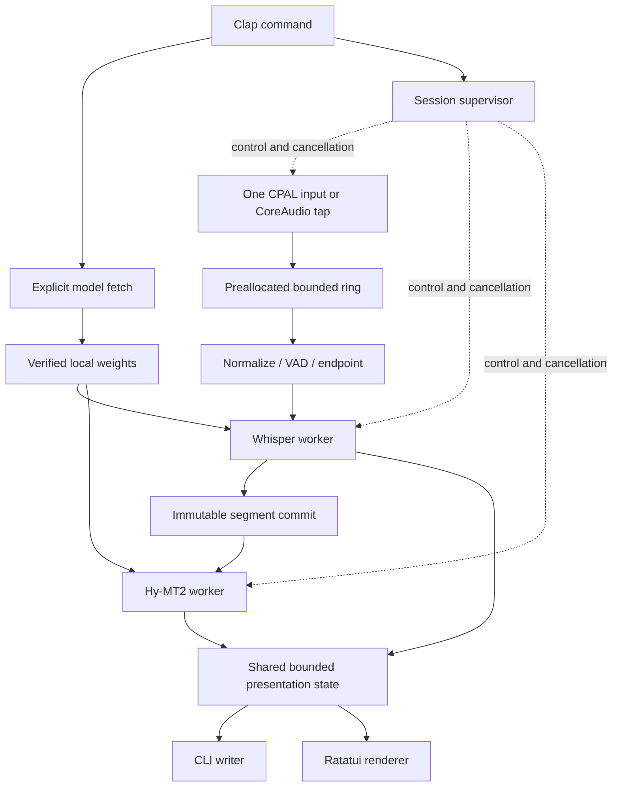

# ADR 0001: One process with bounded, replaceable stages

Status: **Proposed**. Validation: M0 native-link proof; M2–M4 pipeline tests;
M7 resource qualification.

## Context and goals

taco is one Rust executable with CLI and TUI entry points. Audio capture must stay
responsive when local ASR or translation is slow. The selected stack includes two
native inference engines sharing Apple Silicon memory and GPU resources. The
architecture must bound retained data and make failures visible without coupling
capture to terminal rendering or inference execution.

## Non-goals

No daemon, inference server, runtime plugin system, cross-process protocol,
multi-source mixer, recording service, or generalized workflow engine. Replaceable
stages mean internal interfaces, not stable public SDKs in v0.1.

## Decision

Use one supervisor, narrow stage interfaces, dedicated native inference workers,
and Tokio for control and coordination. Keep platform callbacks outside Tokio's
ordinary async scheduling path. Do not call blocking inference on an async executor
thread. Keep model objects worker-owned and initialize each model once per session.

CLI and TUI are alternative presentation adapters for one session, not two consumers
that duplicate model work. Model fetching is a separate invocation and cannot be
entered from a running session. The session construction path receives local model
handles and no download capability.

Separate logical modules for capture, audio normalization, segmentation, ASR,
translation, session state, model management, and terminal presentation. Ship one
library and one binary, both named `taco`. Do not create a crate per box, a second
user-facing binary, or a spike tool that becomes the product. A static library is
allowed only when the M0 link record requires it for symbol isolation. Native
adapters have explicit ownership and teardown contracts. The session module accepts
model handles and does not call the fetch client.

## Data and control contracts

- Audio frames carry source generation, sequence, frame count, sample format/rate,
  channels, and a monotonic sample-time mapping. Use sample indices for media time.
- Loss is a first-class discontinuity with a missing range or explicit unknown
  duration. Never stitch across a gap as though audio were continuous.
- Drafts are replaceable per utterance. Commits are immutable and have unique IDs.
- Each committed segment receives one translation outcome: complete, failed,
  skipped due to overload, timed out, or cancelled. Failure is not an empty success.
- Status and cancellation use a separate bounded control path. A full subtitle queue
  must not prevent stop, source-loss reporting, or terminal restoration.

The [segment ADR](0003-segment-contract.md) defines identities and lifetimes.
The [acceptance plan](../roadmap/acceptance.md) owns numerical limits; implementations
must not create conflicting defaults in individual stages.

## Backpressure and boundedness

Every retained collection needs a capacity in both item count and maximum item size
where applicable. Include hidden copies, resampler buffers, VAD state, native model
contexts, token output, UI scrollback, and telemetry aggregation. A bounded channel
alone does not establish bounded process memory.

The capture callback writes to a preallocated wait-free ring without blocking,
allocation, format conversion, logging, locking, Tokio, or inference. On a full
ring it drops the incoming frames and increments a wait-free loss counter. The consumer skips stale queued audio at
the freshness limit and resets segmentation at a gap. Loss counters and the latest
sample sequence stay readable when the status channel is saturated. Status events
are a bounded ring; dropping an old status event must not drop a loss count, a
commit, or a translation outcome. Use a maintained bounded ring rather than a
hand-rolled lock-free structure, unless M0 records why no such ring can run in the
callback.

Endpoint work is bounded separately from raw audio. If ASR cannot accept a completed
utterance, mark the interval as untranscribed and release it. If translation cannot
accept a commit, retain its source subtitle subject to the UI retention cap and
record `skipped_overload`. Do not retry endlessly or delay capture to preserve every
segment. Healthy qualified workloads must meet **zero loss/skip** release gates;
graceful degradation is for exceptional overload, not permission to pass by dropping
hard speech. Coalesce drafts and UI redraws; never coalesce away final outcomes.

## Alternatives and consequences

An unbounded async pipeline is easy to prototype but violates the charter under
continuous speech. A single inference loop would couple endpointing and translation
latency. Separate inference services would simplify native-library isolation but
violate the single-process service boundary. In-process native failures cannot all
be recovered: ordinary errors are supervised, but a foreign-library abort is a
release-blocking defect, not something Rust panic handling can promise to contain.

## Acceptance criteria

- [ ] Fake stages can replace each boundary without macOS hardware or model files.
- [ ] Stalling translation, ASR, or stdout independently never blocks audio callback
  progress; each produces the specified bounded degradation or session failure.
- [ ] Saturation tests account for lost audio and every committed segment outcome.
- [ ] A resource inventory proves finite limits for every owned buffer and context.
- [ ] Both native engines coexist in the shipped binary without unresolved/duplicate
  symbols, conflicting backend initialization, or an external inference process.
