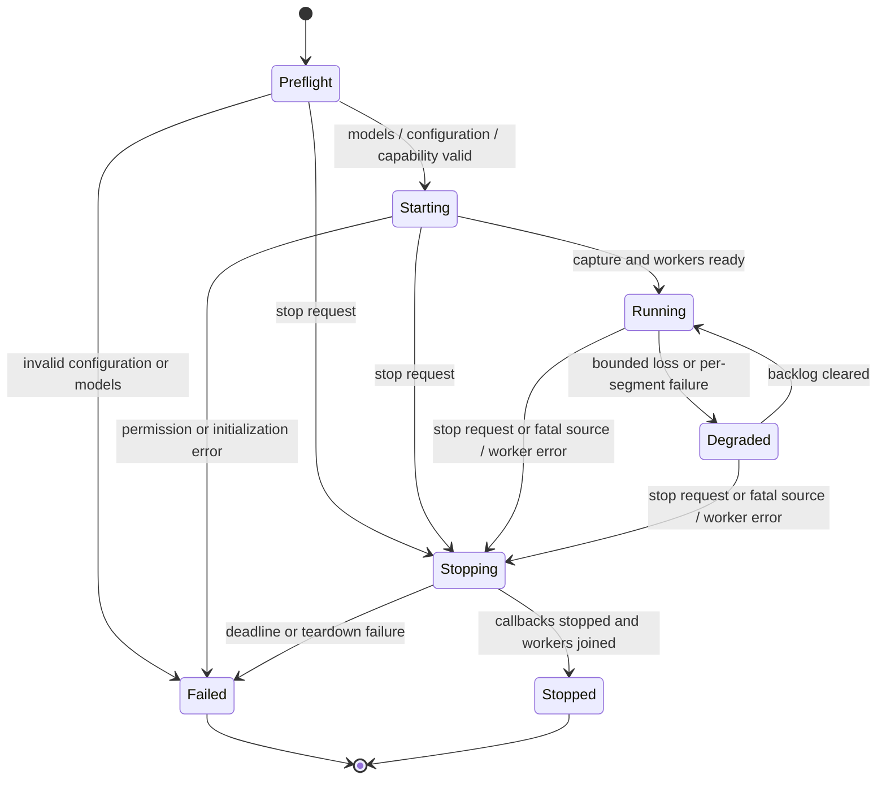

# ADR 0006: Supervised sessions and a shared terminal state model

Status: **Proposed**. Validation: M0 contracts, M2 lifecycle, M4 full pipeline,
M6 terminal behavior, M7 distribution qualification.

## Context and goals

Users need understandable source/translation status and a reliable terminal after
permission errors, broken pipes, source loss, model errors, and interruption. The CLI
and TUI should present the same committed data and failure semantics. Stop handling
must respect actual native-worker ownership rather than merely cancelling a future.

## Non-goals

No transcript browsing/search, interactive source switching during a session,
background service, remotely controlled session, stable machine-readable API, or
automatic continuation with a different source/model/language.

## Decision

Use a session state machine:



Returning from `Degraded` to `Running` does not clear taint. Fatal source, worker,
and output failures go to `Stopping`, not to `Degraded`.

Startup orders configuration and model verification before permission and capture.
Do not capture while models are still loading. On partial initialization failure,
tear down only resources this attempt acquired. Status uses a closed set:
`listening`, `speech`, `pending`, `degraded`, `stopping`, and `error`. Those lines
do not include transcript text.

`taint` is sticky. Recoverable events set it and may move `Running` to `Degraded`.
When queues drain, the state may return to `Running` while taint and the counters
stay. A later normal stop of a tainted session exits 1.

Recoverable, session continues: a ring or freshness drop, an untranscribed
utterance because the ASR queue was full, `empty_decode`, `skipped_overload`, and
a per-segment `failed` or `timed_out` whose worker actually returned.

Fatal, enter `Stopping`: the selected source disappears, the application exits, that
source's route changes, permission is revoked, sleep or wake breaks the stream, the
callback fails unrecoverably, a native worker misses its deadline and does not
return, the model context fails, or output stays blocked past its deadline. Do not
spawn another inference worker to get out of a fatal state. An invariant breach
such as overlapping owned intervals or a second outcome is fatal too: stop with a
typed error rather than continuing on a corrupt ledger.

An accepted stop in preflight/starting prevents any later permission callback or model
initialization completion from starting capture. Cancel outstanding requests where
the platform permits, reject late callbacks, and release only resources actually
acquired. Native initialization cancellation needs its own M0 evidence; inference
abort support does not imply that model loading can also be interrupted safely.

Graceful stop first stops capture admission, flushes a valid unfinished utterance
within the remaining deadline, drains admitted final work, and then joins workers.
If the grace period expires, request cooperative cancellation and assign terminal
cancellation outcomes to outstanding work. Native results arriving afterward cannot
replace them. Resources remain owned until workers actually stop. Restore local
terminal modes before any last-resort process termination. M0 must prove a bounded native exit
path; forced termination is an error outcome, never successful completion or evidence
that unsafe resources were freed while still in use. A second interrupt requests
immediate cancellation rather than an additional drain period.

Recoverable per-segment errors do not restart models indefinitely. An engine/context
failure stops the session with its reason. Missing devices/permissions/models are
expected errors with remediation text, not panics. Uncatchable native crashes remain
release blockers; do not advertise universal crash containment in one process.

## Proposed command contract

These commands are design examples, **not currently runnable**. M0 freezes spelling,
then M6 implements them using Clap conventions.

```text
taco --help
taco --version
taco notices
taco sources list
taco models list
taco models fetch [--model-dir <path>]
taco models verify [--model-dir <path>]
taco run --source <selector> --from <tag> --to <tag> [--ui cli|tui] [--model-dir <path>]
```

There is no `--profile`, URL, config file, `--insecure`, `--translate`, or
auto-detect flag. `--from` and `--to` are tags in the frozen table. Unsupported or
identical pairs fail before capture with exit 1. Exactly one selector is required.
The default UI is CLI. TUI is opt-in and requires a usable terminal. Help, version,
notices, parse errors, and listings must not initialize models or capture. Unknown
flags and missing required arguments exit 2. A well-formed value that fails
preflight exits 1.

CLI stdout is one ledger record per line and contains no ANSI cursor controls:

```text
commit <id> <epoch> <start-sample> <end-sample> <endpoint-reason> <escaped-source>
outcome <id> <outcome> <escaped-target-or-empty>
```

Escaping keeps printable Unicode, including CJK, as itself, and escapes controls,
backslashes, and newlines. Stderr status lines are `status <code> ...` without
transcript text. This format is stable for the v0.1 qualification harness. It is
not a promise of a public JSON API. TUI reads the same ledger and does not emit
these lines.

CLI does not read stdin and does not enter raw mode. `q` is TUI-only. CLI stop is
SIGINT or SIGTERM. Default CLI output is append-only and does not emit mutable
drafts. TUI shows the active draft, bounded recent committed rows, pending and
completed translation, source, language pair, and status. A source row need not
wait for its translation. Both modes use the same outcome multiset. No automatic
transcript file is opened.

Sanitize control characters in model output, transcript text, and device/app labels
before terminal rendering. Treat escape sequences, OSC hyperlinks/clipboard commands,
newlines, and bidi controls according to a documented visible/escaped-text policy;
never execute model text as terminal control. Preserve ordinary Unicode, CJK, and
combining characters without splitting invalid UTF-8. Test narrow layouts and resize.

Output has bounded buffering. A slow or broken stdout or stderr cannot block capture
or the stop path. If a final record or a status write cannot be accepted within the
acceptance-plan deadline, stop with `output_stalled`. Droppable status must not
delay a final record. Do not claim a completed subtitle was displayed merely because it was
queued. TUI may coalesce redraws; its current state still has finite row/text caps.

Use a cancellation-aware, bounded output adapter with nonblocking writes where the
OS supports them; an uninterruptible writer thread is not a bounded shutdown strategy.
Track generated, queued, sink-accepted and independently observed presentation times
separately. The [measurement contract](../roadmap/acceptance.md) defines the delivery
proxy and its limits. Restore local termios state independently of output progress.
Cursor/alternate-screen restoration requires the terminal to accept escape sequences:
attempt it within the output deadline, but record failure if the sink is broken or
stalled. Do not promise visual restoration on a disconnected terminal.

Exit codes, first matching row wins:

| Situation | Code |
| --- | --- |
| `--help`, `--version`, `notices` | 0 |
| Unknown flag or missing required argument | 2 |
| Teardown misses the shutdown budget, whatever the signal | 1 |
| Preflight, permission, source, model, output stall, or other fatal error. A user interrupt is not this row | 1 |
| SIGINT after teardown finishes inside the budget | 130 |
| `q` or SIGTERM, teardown finished, session not tainted | 0 |
| `q` or SIGTERM, teardown finished, session tainted | 1 |

A second SIGINT skips the remaining drain and still uses this table. SIGTERM is a
graceful stop, not exit 143. The summary on stderr still lists loss and outcome
counts for every stop.

## Alternatives and consequences

Separate CLI and TUI pipelines would drift on commit and failure behavior. A shared
bounded state model reduces that risk. A fully lossless output queue would eventually
block or grow without bound on a stalled terminal, so explicit output failure is
preferable. Disallowing live reconfiguration keeps lifecycle and privacy boundaries
small for v0.1.

## Acceptance criteria

- [ ] State transition tests cover every edge, partial startup, repeated stop, and
  stale results; stopped means capture is stopped and native workers are joined.
- [ ] Pseudoterminal tests demonstrate restoration of local terminal mode after normal
  exit, interrupt, resize, and ordinary errors; responsive sinks also restore cursor
  and alternate screen. Blocked terminal output terminates within budget and reports
  visual restoration failure without hanging local-mode restoration.
- [ ] Slow stdout, broken pipe, dropped UI consumer, and saturated status paths cannot
  starve cancellation; no private content appears in error logs.
- [ ] CLI/TUI receive identical commit/outcome sequences and show source plus target
  association correctly, including failed/skipped outcomes and evicted TUI rows.
- [ ] Control-sequence fixtures cannot alter terminal title, clipboard, or commands;
  unsupported language/source/UI choices fail before capture starts.
