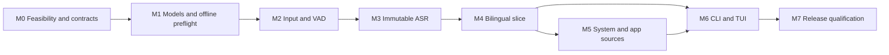

# taco v0.1 roadmap

Build a private, local speech translator for macOS Apple Silicon: install one Rust
executable, explicitly fetch models, select one supported audio source, and read live
source text and translations in a CLI or TUI for a qualified 60-minute offline session.
The [charter](../../CHARTER.md) is the product authority.

**Current state:** planning only. No source, build system, executable, tests, model
artifacts, or benchmark results exist in this checkout. All milestones below are
**not started**. ADRs are proposed and still binding on implementers. Numerical
targets are provisional until M0, and no hardware or language support claim has
been qualified.

Implementers start with the [agent contract](agent-contract.md) and the
[test catalog](test-catalog.md), then the milestone they were given. Those files
are the drift controls. They do not mark a milestone accepted.

## Goals

- Deliver all five v0.1 charter capabilities, including each of the four source
  categories and both terminal modes.
- Retire platform, native-linking, model, and latency risks before extensive UX work.
- Give each implementation milestone a bounded deliverable, explicit non-goals,
  tests to write first, observable acceptance criteria, and a handoff gate.
- Keep implementation evidence distinct from model quality, hardware, and release
  evidence. A demo is useful progress but does not satisfy the release gate.

## Non-goals

v0.1 excludes TTS, playback/recording, stdin or file audio, multi-source mixing,
diarization, transcript history/search, a config file, GUI, cloud inference, and
non-macOS platforms. There is no runtime daemon or external inference service. The
north star permits later synchronized speech or subtitle outputs and bidirectional
interpretation; none is smuggled into v0.1 through a generic framework, a debug
dump flag, or a mandatory prerequisite.

## Milestones and dependencies

| Milestone | User or engineering outcome | Depends on | Completion evidence |
| --- | --- | --- | --- |
| [M0: Feasibility and contracts](m0-feasibility.md) | Prove the chosen stack can fit the distribution and runtime contract | Charter | Pinned integration spike, acceptance plan, and decision register |
| [M1: Models and offline preflight](m1-models.md) | Fetch verified weights once; start without network dependency | M0 | Artifact lifecycle and negative network tests |
| [M2: Input capture and VAD](m2-capture.md) | Select microphone/input and produce bounded speech windows | M0, M1 | Real input capture plus deterministic timing/loss tests |
| [M3: Streaming transcript](m3-transcription.md) | See stable source subtitles with immutable commits | M2 | Segment tests and ASR quality/latency report |
| [M4: Local bilingual slice](m4-translation.md) | Read local translations tied to committed source segments | M3 | Joint-model end-to-end metrics and outcome accounting |
| [M5: System and app capture](m5-system-audio.md) | Translate one selected system/application source | M4; M0 tap proof | Source isolation, permissions, cleanup, real-source runs |
| [M6: CLI/TUI completion](m6-terminal.md) | Use coherent commands and a reliable terminal session | M4; M5 for full-source acceptance | PTY, lifecycle, source-selection and UX evidence |
| [M7: Release qualification](m7-release.md) | Install and run the exact distributable against all v0.1 gates | M1–M6 | Complete qualification matrix and release decision |

This graph expresses exit dependencies, not a prohibition on parallel preparation.
After M0, tap adapter work and terminal sketches may proceed independently; they
cannot pass their integrated milestones before the prerequisite contracts and
pipeline exist. M0 includes tap and packaging spikes so a late M5 failure does not
become the first discovery that the single-file product cannot capture apps.

## Delivery rules

Use capability gates rather than unsupported dates or staffing estimates. M0 has
bounded experiments and explicit stop decisions; it is not an open-ended research
phase. Estimate calendar work after its results identify the actual integration cost.
Each milestone names accountable roles rather than inventing assigned people; one
engineer can hold several roles, but acceptance evidence still needs review.

Implement vertical increments behind the final internal interfaces. Write the named
behavioral tests first, confirm they fail for the intended missing behavior, implement
the smallest passing change, then add hardware/model evidence where required. Do not
use artificial always-failing tests or assert the implementation's own constants as
proof of product behavior. Run the default test tier before the native and manual tiers. Source and test
implementation is **future work**. This planning review stays inside `docs/adr/`
and `docs/roadmap/`.

An exit gate requires linked evidence, no unresolved mandatory acceptance item, and a
reviewer who can reproduce the result. A missing machine, permission, fixture license,
or native cancellation hook is a recorded blocker, not a waived test. A changed
charter commitment requires an explicit product decision; a failed release run cannot
be reclassified as a successful narrower release.

## Reading order and acceptance of this plan

1. [Agent contract](agent-contract.md) and [test catalog](test-catalog.md) bind implementation.
2. [Architecture decisions](../adr/README.md) explain the proposed system.
3. [Acceptance plan](acceptance.md) is the only numeric budget and matrix.
4. The milestone files define buildable work in dependency order.
5. [Charter coverage](charter-coverage.md) maps every promise to its gate.
6. [Risks and decisions](risks-and-decisions.md) identifies unresolved choices.
7. [Planning review](planning-review.md) records the documentation review.

The planning deliverable is complete when those documents are consistent, the full
charter is covered, all milestones state goals/non-goals/testable acceptance criteria,
and the write boundary is verified. Product completion remains M7; documentation
completion does not check off implementation milestones.
